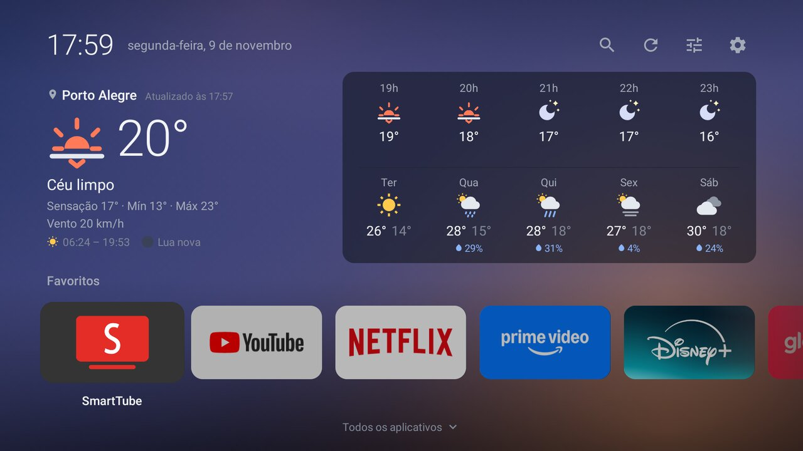
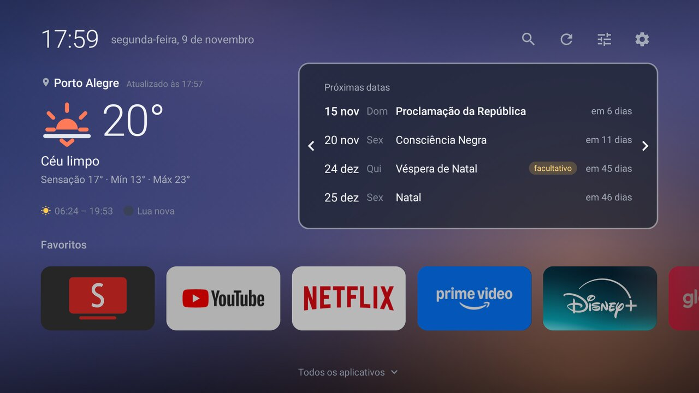
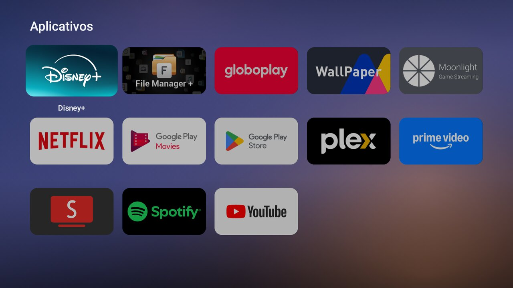
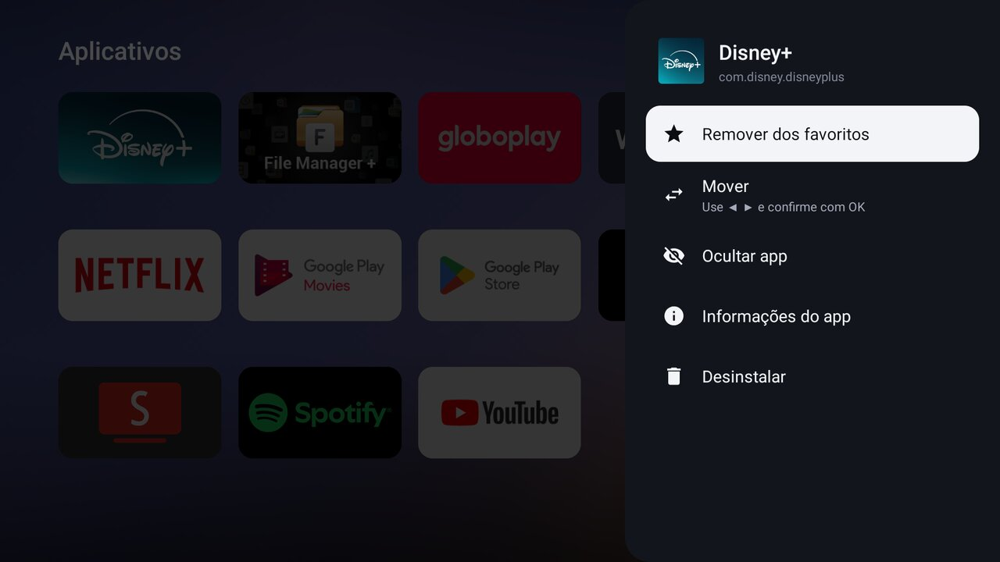
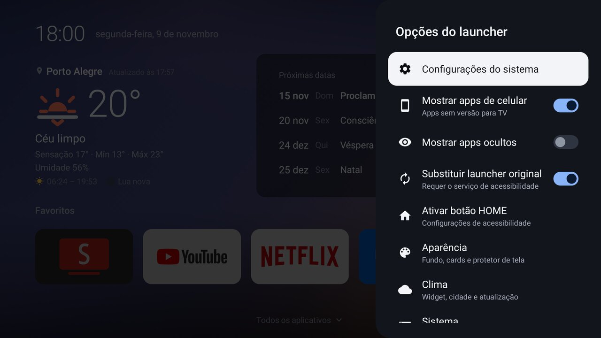

# TV Launcher

Launcher leve e personalizado para Android TV, feito para o **Xiaomi Mi TV Stick (MDZ-24-AA)**
(Android TV 9, 1 GB de RAM), mas funciona em qualquer Android TV com API 21 ou superior.



| Próximas datas | Todos os apps |
| --- | --- |
|  |  |
| **Menu do app** | **Opções do launcher** |
|  |  |

- APK de ~310 KB, sem Leanback/Compose/AppCompat: só `Activity` + `RecyclerView`
- Relógio e data, **widget de clima**, linha de **Favoritos** (ordenável) e grade de **todos os apps**
- Usa o banner 16:9 dos apps de TV; apps de celular (sideload) aparecem com ícone e nome
- Menu lateral do app (segure OK ou aperte MENU): favoritar, mover (◀ ▶ e OK para confirmar), ocultar, informações, desinstalar
- Tela inicial com o clima em cima e os favoritos embaixo; ▼ nos favoritos desliza para a grade
  em tela cheia, ▲ na primeira linha volta
- **Busca de apps:** a lupa no topo (ou o botão de busca do controle) abre um campo; os resultados
  aparecem enquanto você digita, sem diferenciar maiúsculas nem acentos
- **Tamanho dos cards:** grandes, médios ou pequenos (4, 5 ou 6 por linha na grade; os favoritos
  acompanham), em *Opções do launcher → Aparência → Tamanho dos cards*
- **Rede** no topo: botão fixo com o tipo de conexão (Wi-Fi com nível de sinal, cabo ou vermelho
  com aviso "Sem internet") que abre as configurações de rede do Android. Fica sempre visível,
  independente do toggle de status. Quando a internet volta, o clima que tinha falhado é buscado
  de novo na hora
- **Status do sistema** no topo: espaço livre e RAM livre. O espaço fica âmbar abaixo de 500 MB.
  *Opções do launcher → Sistema* mostra os totais, liga ou desliga esses indicadores e abre a tela
  de armazenamento do Android
- **Protetor de tela** próprio: o fundo dinâmico em tela cheia com relógio, data e clima (veja
  [Protetor de tela](#protetor-de-tela))
- **Atualização pelo próprio launcher:** avisa quando há versão nova e instala por dentro do app
  (veja [Atualização](#atualização))
- Foco sem contorno: o card focado cresce e acende, os demais ficam levemente esmaecidos
- Atualiza sozinho quando um app é instalado ou removido
- Serviço de acessibilidade **opcional** para o botão HOME abrir este launcher sem root

## Widget de clima

Mostra o tempo agora (temperatura, condição, sensação térmica, mínima/máxima do dia, umidade e
vento) e, à direita, 5 colunas: na linha de cima as próximas 5 horas, na de baixo os próximos 5
dias, com a chance de chuva quando houver.

- **Localização:** automática pela geolocalização do IP. Se cair na cidade errada (comum quando o
  provedor roteia por outra cidade), use **Opções do launcher → Clima → Escolher cidade**: selecione
  o campo, digite com o teclado da TV, confirme e escolha na lista. *Usar localização automática*
  volta ao modo por IP.
- **Fundo dinâmico:** degradê diagonal suave com manchas de cor elípticas (estilo mesh gradient) que acompanha a hora do dia (noite, aurora, nascer do sol,
  manhã, meio-dia, tarde, pôr do sol, crepúsculo), calculado com o nascer/pôr do sol reais da
  cidade, e o clima atual (nuvens dessaturam e escurecem; chuva, tempestade, neblina e neve dão um
  tom próprio). As mudanças são animadas. O céu é desenhado num bitmap de 192x108 esticado com
  filtro, então custa na GPU o mesmo que um degradê simples. Liga/desliga em
  *Opções do launcher → Aparência → Fundo dinâmico* (desligado volta ao fundo escuro fixo).
- **Estilos do fundo** (*Opções do launcher → Aparência → Estilo do fundo*, troca com fade): Mesh sóbrio,
  Aurora (faixas de luz onduladas), Tonal suave, Vibrante, Minimal escuro e Duotone. Todos seguem
  a hora do dia e o clima.
- **Ícones por hora do dia:** amanhecer e pôr do sol têm ícones próprios, a noite mostra lua e
  estrelas, e chuva/garoa/neve/neblina leves mostram o sol, o sol baixo ou a lua atrás da nuvem.
  Vale para o tempo atual e para as próximas horas.
- **Avisos:** uma faixa âmbar aparece quando há tempestade ou chuva forte nas próximas 12 horas,
  ou chuva provável (70% ou mais) nas próximas 3 horas.
- **Qualidade do ar e UV:** índice de qualidade do ar (escala dos EUA) e índice UV de agora, com a
  faixa por extenso. Se a consulta do ar falhar, a previsão aparece sem ela.
- **Linha que reveza:** umidade, vento, qualidade do ar e UV dividem a mesma linha e se alternam
  a cada 4,5 s com um fade curto (pausa quando o launcher sai da tela).
- **Próximas datas:** o painel da previsão é selecionável (▲ a partir dos favoritos). Com ele
  focado aparecem as setas ‹ › nas laterais, e ◀ ▶ deslizam para a lista das 4 próximas datas —
  feriados nacionais, pontos facultativos (Carnaval, Cinzas, Corpus Christi, vésperas de Natal e
  Ano-Novo) e datas comemorativas (Páscoa, Dia das Mães, dos Namorados, dos Pais) —, com a
  contagem de dias e o selo "emenda" quando o feriado cai numa terça ou quinta. ▼ volta aos
  favoritos. Tudo é calculado no aparelho (a Páscoa e as datas móveis também). Liga/desliga em
  *Opções do launcher → Clima → Mostrar próximas datas* (desligado, o painel não recebe foco).
- **Sol e lua:** horários do nascer e do pôr do sol e a fase da lua (calculada no aparelho; o
  disco é espelhado no hemisfério sul).
- **Atualizar na hora:** botão ⟳ ao lado das opções no topo (gira enquanto busca).
- **Atualização:** a cada 30 min (ajustável em *Clima → Atualização automática*: 15 min a 6 h, ou
  desligada para atualizar só pelo botão de atualizar) enquanto o launcher está na tela (5 min após uma falha). A última
  previsão fica salva e aparece na hora ao ligar a TV, mesmo sem rede.
- **Desligar:** *Opções do launcher → Clima → Mostrar widget de clima*.
- **Privacidade / serviços usados** (todos HTTPS, sem conta nem chave):
  - [Open-Meteo](https://open-meteo.com) para a previsão, a qualidade do ar e a busca de cidades (recebe só as
    coordenadas ou o nome buscado);
  - [ipwho.is](https://ipwho.is) com fallback para [ipapi.co](https://ipapi.co), **apenas no modo
    automático**, para descobrir a cidade pelo IP (consulta no máximo a cada 12 h);
  - [GitHub](https://github.com/korsarts/tv-launcher) para consultar e baixar versões novas do
    launcher (no máximo uma consulta por dia; dá para desligar em *Sobre*).

## Atualização

Uma vez por dia, ao voltar para a tela inicial, o launcher consulta o último release deste
repositório no GitHub. Havendo versão mais nova, aparece "Nova versão disponível" no topo e o item
**Atualizar para X** no começo de *Opções do launcher*. *Baixar e instalar* baixa o APK e chama o
instalador do Android, que pede a sua confirmação; o launcher reabre na versão nova.

- **Na primeira vez**, o Android pede para liberar o TV Launcher como fonte de instalação
  (*Segurança e restrições → Fontes desconhecidas*). Libere e escolha *Baixar e instalar* de novo.
- **A assinatura precisa ser a mesma.** O Android só instala por cima se o APK do release foi
  assinado com a mesma chave do que está instalado (veja [Assinatura](#assinatura)). Um APK local
  assinado com a chave de debug não é atualizado por um release assinado com a sua chave: nesse
  caso, desinstale e instale o APK do release uma vez.
- *Opções do launcher → Sobre* tem **Verificar atualizações** (consulta na hora), o liga/desliga
  da verificação automática, as novidades de cada versão e a lista de serviços acessados.
- O texto do release é o título do commit da tag (ex.: `1.11.0: ...`), preenchido pelo workflow.

## Protetor de tela

O launcher registra um protetor de tela do Android com o céu dinâmico (no estilo escolhido), o
relógio, a data e o clima atual. O bloco muda de lugar a cada 2 minutos para não marcar a tela, e
a previsão segue o intervalo de atualização configurado no launcher.

Para ativar: *Opções do launcher → Aparência → Protetor de tela → Abrir configurações do protetor*
(ou **Configurações → Preferências do dispositivo → Protetor de tela**) e escolha
**TV Launcher: relógio e clima**. *Testar agora* inicia na hora o protetor que estiver escolhido.

Se a TV não listar protetores de outros apps, dá para definir por ADB:
```bash
adb shell settings put secure screensaver_components com.korsarts.tvlauncher/.ScreensaverService
adb shell settings put secure screensaver_enabled 1
```

## Instalação no Mi TV Stick

1. No stick: **Configurações → Preferências do dispositivo → Sobre → Build**, clique 7 vezes
   para habilitar as Opções do desenvolvedor. Em **Opções do desenvolvedor**, ative **Depuração USB**
   (para ADB via rede) ou permita **Fontes desconhecidas** para o app que vai instalar o APK.
2. Instale o APK por um destes caminhos:
   - **ADB pela rede** (PC na mesma rede):
     ```bash
     adb connect IP_DO_STICK:5555
     adb install -r tv-launcher.apk
     ```
   - **Send Files to TV / Downloader / pendrive com gerenciador de arquivos.**
3. Abra o "TV Launcher" na lista de apps.

## Fazer o botão HOME abrir o TV Launcher

O Android TV não tem seletor de launcher padrão: o HOME sempre abre o launcher do sistema
(`com.google.android.tvlauncher`). Há duas formas de contornar:

**A) Sem PC (acessibilidade):** no launcher, ⚙ de opções → *Ativar botão HOME (Acessibilidade)* →
ative **TV Launcher – botão HOME**. O serviço consome o `KEYCODE_HOME` e também troca o launcher
original pelo nosso se ele aparecer (por exemplo, após o boot). Não lê o conteúdo da tela.

**B) ADB (definitivo):** desabilita o launcher original, e o nosso passa a ser o único HOME.
```bash
adb shell pm disable-user --user 0 com.google.android.tvlauncher
```
Para reverter:
```bash
adb shell pm enable com.google.android.tvlauncher
```
> Com o launcher original desabilitado, a linha de recomendações e o atalho de entradas do
> Google somem. As configurações continuam acessíveis pelo ícone de engrenagem.

### Se o HOME continuar abrindo o launcher original

- **Definir como preferido não basta.** O `tvlauncher` declara o HOME com prioridade 2, e o
  Android 9 sempre escolhe o candidato de maior prioridade sem consultar a preferência. Por isso
  `adb shell cmd package set-home-activity com.korsarts.tvlauncher/.MainActivity` retorna
  `Success` mas não muda nada enquanto o launcher original estiver habilitado. Use a opção **B**.
  Ainda vale rodar esse comando se houver outro launcher instalado (Projectivy, ATV Launcher...),
  para o sistema escolher o nosso entre os que sobram.
- **Outro launcher pode estar capturando o botão.** Launchers como o Projectivy têm o próprio
  serviço de acessibilidade, que consome o HOME antes do nosso. Veja quais estão ativos:
  ```bash
  adb shell settings get secure enabled_accessibility_services
  ```
  Deixe só o nosso (isso substitui a lista inteira):
  ```bash
  adb shell settings put secure enabled_accessibility_services com.korsarts.tvlauncher/com.korsarts.tvlauncher.HomeButtonService
  adb shell settings put secure accessibility_enabled 1
  ```
- **Para conferir** qual app o sistema abre no HOME:
  ```bash
  adb shell cmd package resolve-activity --brief -a android.intent.action.MAIN -c android.intent.category.HOME
  ```
  A última linha deve ser `com.korsarts.tvlauncher/.MainActivity`.

## Build

Requisitos: JDK 17+ e Android SDK (platform 35, build-tools 35).

```bash
./gradlew assembleRelease
```
APK em `app/build/outputs/apk/release/app-release.apk`.

### Assinatura

- **Local:** crie `keystore.properties` na raiz (já está no `.gitignore`):
  ```properties
  storeFile=release.jks
  storePassword=...
  keyAlias=tvlauncher
  keyPassword=...
  ```
- **GitHub Actions:** adicione os secrets `KEYSTORE_BASE64` (`base64 -w0 release.jks`),
  `SIGNING_STORE_PASSWORD`, `SIGNING_KEY_ALIAS` e `SIGNING_KEY_PASSWORD`.
- Sem keystore, o APK é assinado com a chave de debug. Funciona, mas atualizações só instalam
  por cima se a chave for a mesma.

O workflow gera o APK como artefato em todo push e publica um Release ao criar uma tag `v*`.
